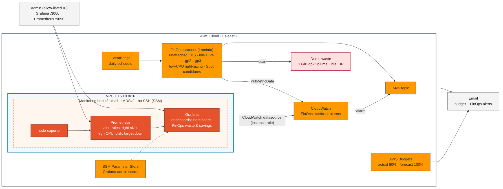
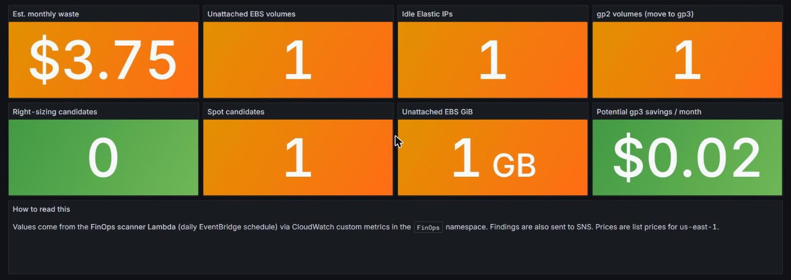
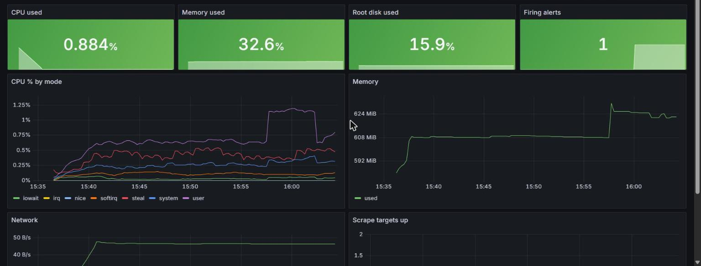
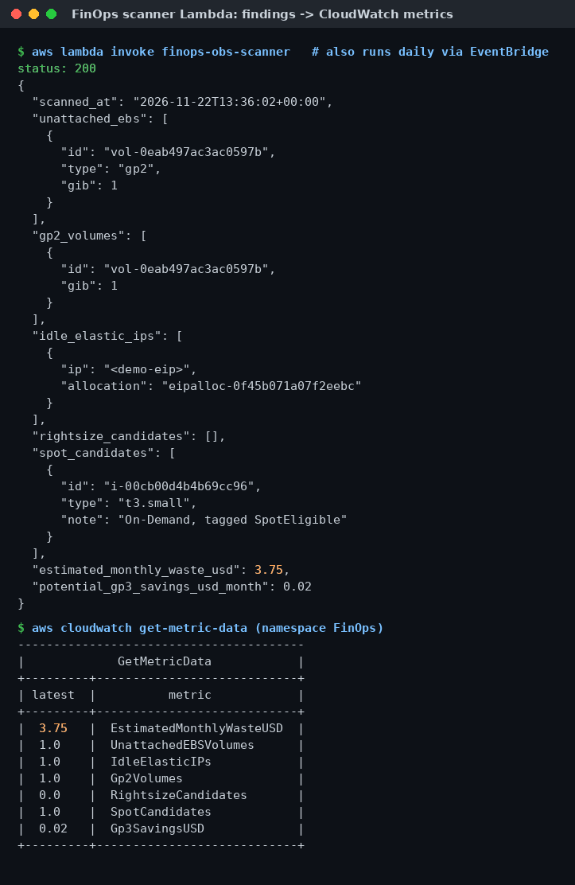
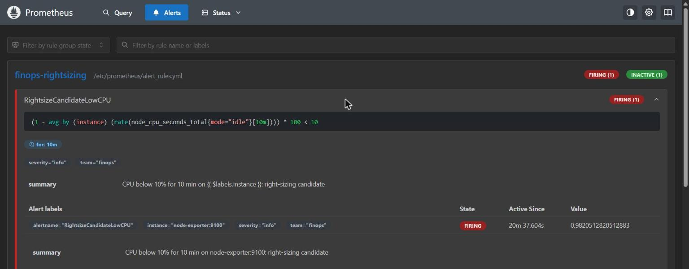
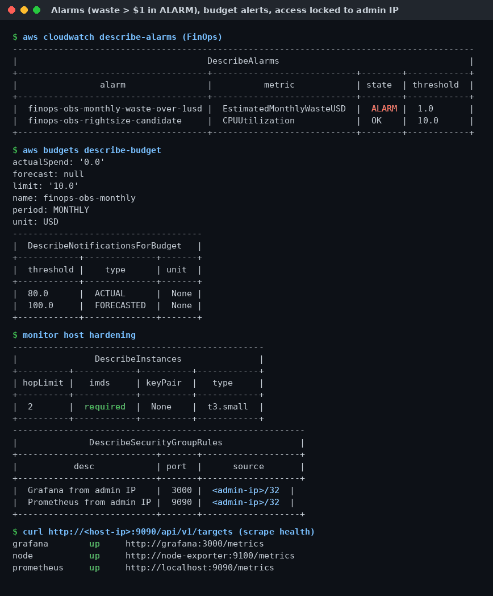

# AWS FinOps & Observability: Prometheus/Grafana + Automated Waste Scanner


A small, production-style observability and cost-control stack, all in Terraform. **Prometheus + Grafana** watch the hosts and fire right-sizing alerts. A **FinOps scanner Lambda** runs daily, finds avoidable spend (unattached EBS, idle Elastic IPs, gp2 volumes, low-CPU instances, Spot-eligible On-Demand instances), publishes it as CloudWatch metrics that Grafana graphs, and alerts by email. **AWS Budgets** adds actual and forecast spend alerts.



## Verified deployment (2026-11-22, us-east-1)

Deployed with `terraform apply`, checked against live AWS, then destroyed. Every screenshot is real output; account ID and IPs are redacted.

| Check | Result |
|---|---|
| Grafana and Prometheus reachable from the admin IP only | security group allows 3000/9090 from one /32; no SSH, no key pair, sshd disabled |
| Prometheus scrape targets | prometheus, node-exporter, grafana: all `up` |
| Prometheus right-sizing alert | `RightsizeCandidateLowCPU` **FIRING** (CPU 0.98% for over 10 min) |
| FinOps scanner Lambda | 1 unattached EBS volume, 1 gp2 volume, 1 idle Elastic IP, 1 Spot candidate, **$3.75/month waste** |
| CloudWatch alarm | `finops-obs-monthly-waste-over-1usd` went to **ALARM** and notified SNS |
| AWS Budget | $10/month, alerts at 80% actual and 100% forecast |
| Host hardening | IMDSv2 required, hop limit 2, encrypted gp3 root volume |
| Teardown | `terraform destroy` plus an audit of EC2, EIP, EBS, Lambda, VPC and Budgets: nothing left |

**Lesson learned.** On a brand-new instance, the scanner reported 0 right-sizing candidates. Its rule needs 24h of CloudWatch CPU data, and only minutes existed. The Prometheus rule fired within 10 minutes. That is why the stack uses both: Prometheus catches waste fast, and the daily Lambda confirms it with longer history before anyone resizes.

| | |
|---|---|
|  |  |
|  |  |
|  | |


## What this demonstrates

| Capability | Implementation |
|---|---|
| Metrics & dashboards | Prometheus v3 + node-exporter + Grafana 12 (Docker Compose), dashboards and data sources provisioned as code |
| Right-sizing signals | Prometheus rules `RightsizeCandidateLowCPU` / `LowMemory`, plus a CloudWatch alarm on 1-hour average CPU |
| Automated waste detection | Python Lambda on a daily EventBridge schedule: unattached EBS, gp2 → gp3 savings, idle EIPs, low-CPU instances (24 h CloudWatch average), Spot candidates |
| Cost metrics in Grafana | Scanner publishes `FinOps/*` CloudWatch metrics; Grafana reads them through the instance role (no keys) |
| Alerting | SNS email for findings, CloudWatch alarm when estimated waste > $1/month, AWS Budgets at 80 % actual / 100 % forecast |
| Least privilege | Scanner is read-only on EC2 and can `PutMetricData` **only** to the `FinOps` namespace. Grafana role is CloudWatch read-only |
| Secure access | No SSH (SSM only), Grafana/Prometheus allow-listed to the admin's IP, IMDSv2, encrypted gp3 root volume, deny-all default SG |
| Secrets | Grafana admin password generated by Terraform, stored as an SSM SecureString, fetched at boot (never in user data or code) |

## FinOps checks and prices used

| Finding | Why it costs money | Recommended action | Price basis (us-east-1) |
|---|---|---|---|
| Unattached EBS volume | Billed per GB-month even when unused | Snapshot if needed, then delete | gp2 $0.10, gp3 $0.08 per GB-month |
| gp2 volume | gp3 is ~20 % cheaper with equal or better baseline performance | Modify volume type to gp3 (online) | $0.02 per GB-month saved |
| Idle Elastic IP | Public IPv4 is billed hourly | Release | $0.005/hr ≈ $3.65/month |
| Running instance < 10 % CPU (24 h) | Over-provisioned | Smaller type or Graviton | — |
| On-Demand tagged `SpotEligible=true` | Spot is typically 60–90 % cheaper | Move to Spot / mixed-instances ASG | — |

## Repository layout

```
terraform/
├── network.tf            # VPC, public subnet, SG (3000/9090 from admin IP only), locked default SG
├── monitor.tf            # t3.small host, IAM (SSM + CloudWatch read), SSM SecureString, IMDSv2
├── finops.tf             # scanner Lambda + EventBridge, SNS, alarms, AWS Budgets, demo waste
├── lambda/finops_scanner.py
├── monitoring/           # docker-compose, Prometheus config + alert rules, Grafana provisioning + dashboards
└── user_data.sh.tftpl
scripts/autopilot.ps1     # deploy -> scan -> capture evidence -> destroy until clean
```

## Deploy

```bash
cd terraform
terraform init
terraform apply -var="admin_cidr=$(curl -s https://checkip.amazonaws.com)/32" -var="alert_email=you@example.com"
terraform output grafana_url
```

Confirm the SNS subscription email, then invoke the scanner (or wait for the daily run):

```bash
aws lambda invoke --function-name finops-obs-scanner out.json && cat out.json
```

## Cost (us-east-1)

| Resource | ~USD/hr |
|---|---|
| EC2 t3.small (free-tier eligible) | 0.021 |
| Public IPv4 (instance) | 0.005 |
| Demo idle Elastic IP (intentional waste) | 0.005 |
| Lambda, EventBridge, SNS, 8 custom metrics, 2 alarms, budget | < 0.005 |
| **Total** | **~0.035** |

## Tear down

```bash
cd terraform && terraform destroy -var="admin_cidr=0.0.0.0/32" -var="alert_email=you@example.com"
```

## Production hardening (next steps)

- Amazon Managed Service for Prometheus + Amazon Managed Grafana with SSO, or Grafana behind an ALB + Cognito/OIDC
- Alertmanager → Slack/PagerDuty routes; scanner findings to Security Hub or a ticket queue
- Cost and Usage Report (CUR 2.0) + Athena for per-team showback; activate cost-allocation tags
- AWS Compute Optimizer and Cost Anomaly Detection once the account has 14+ days of history
- Auto-remediation with approval (e.g. Step Functions: snapshot → delete unattached volumes after N days)
